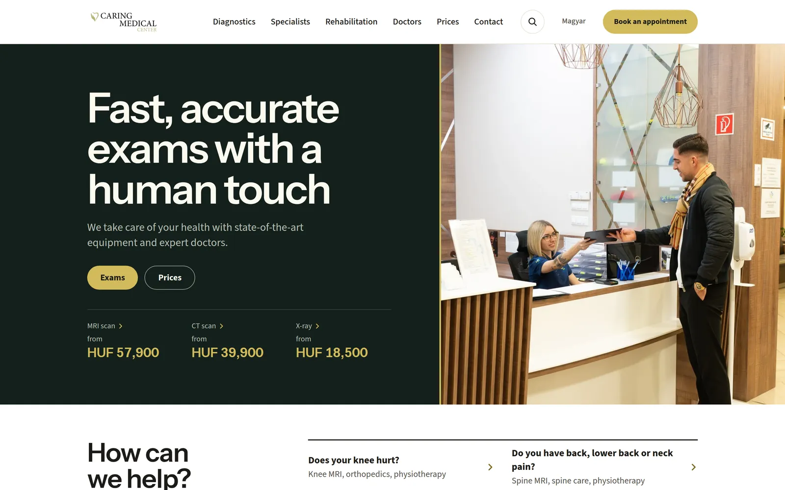

# Caring Medical Center

A website for a Hungarian group of diagnostic, specialist and rehabilitation clinics.

**Demo:** https://caringmedical-site.czobor94.workers.dev

<p>
  
  
</p>

## What it does

- **211 pages in Hungarian and English.** MRI exam pages, specialties, rehabilitation,
  three clinics, doctors, price lists and news, with language versions linked by
  hreflang.
- **Patients start from what hurts.** Complaint pages lead from the exam to the
  specialist and the treatment, with prices pulled from the price list.
- **A non-developer can edit it.** [Sveltia CMS](https://github.com/sveltia/sveltia-cms)
  at `/admin` edits the same Markdown and YAML files. Each save opens a pull request
  with its own preview deployment, and Publish merges it.
- **Retired addresses redirect.** A page that moved or merged answers its old address
  with a 301 to the new one.
- **Privacy by default.** No cookie is set and no third party is contacted before
  consent. The map loads only on a click.
- **Site search** with [Pagefind](https://pagefind.app), one index per language.
- **A contact form without a database.** A small Cloudflare Worker validates the
  message, rate-limits each visitor and emails it to the clinic. Nothing is stored.

## How it's built

- [Astro](https://astro.build), fully static, with Tailwind CSS. No client framework;
  the few interactive parts are small scripts.
- Content collections with Zod schemas, so an unknown price ID, a repeated ID or a
  broken image path fails the build instead of reaching a page.
- Deployed as Cloudflare Workers static assets, with a preview URL for every branch.
- Photos come in several sizes, and phones get crops cut to the space they fill.

## Tests

`pnpm test` builds the site and runs over 1,600 Playwright tests against the production
build. Guardrail tests run on every page: one `h1` and complete metadata, no serious
[axe](https://github.com/dequelabs/axe-core) accessibility violations, and no cookie or
third-party request before consent. Other suites cover the redirects, both languages,
search, the contact API, the CMS configuration and each page type, several at phone and
laptop widths.

## Develop

Needs Node 24 or newer and pnpm (version pinned in `package.json`).

```sh
pnpm install
pnpm dev      # local dev server
pnpm test     # build, then Playwright tests
```

- `src/content/` holds the pages, prices, clinics and doctors as Markdown and YAML;
  `src/content/README.md` explains where each file comes from.
- `src/redirects.json` lists retired addresses and where each now lives; the redirects
  are built from it.
- `worker/` is the script behind `/api/*` (the contact form).

## Content and licence

The texts, photos, logo and price lists belong to Caring Medical Center and are not
licensed for reuse. No licence is granted for the code either; it is published for
reference.
